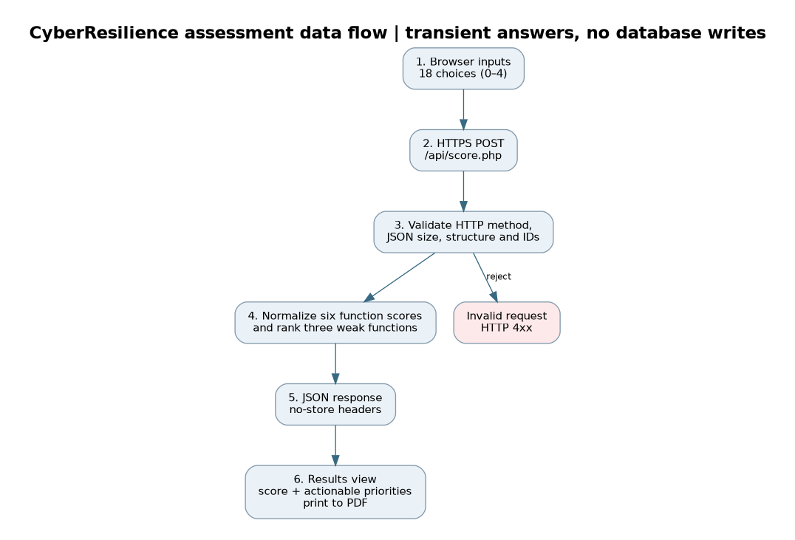
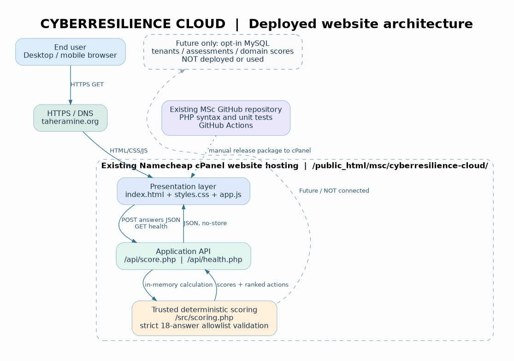

# Architecture and Design Decisions

## Purpose and bounded scope

CyberResilience Cloud provides a concise, explainable readiness snapshot based on NIST CSF 2.0's Govern, Identify, Protect, Detect, Respond, and Recover functions. It supports prioritization for organizations with limited specialist resources; it is not a control audit or an evidence-based certification process.

## Component model

1. **Client:** `web/index.html`, `web/styles.css` and `web/app.js` implement the responsive questionnaire, response-state handling, score display and print rendering.
2. **API:** `web/api/score.php` accepts a JSON POST, validates expected question identifiers and numeric values, and invokes deterministic scoring logic. `web/api/health.php` exposes a minimal health response.
3. **Domain engine:** `web/src/scoring.php` contains the question catalogue, numerical normalization and prioritized-action rules. It is kept separate from the HTTP adapter to enable direct unit tests.
4. **Hosting:** Existing HTTPS PHP-capable hosting serves both static assets and API routes under `/msc/cyberresilience-cloud/`.
5. **Persistence:** None. The current release deliberately avoids storage of user assessments. `docs/future-db-schema.sql` is an illustrative MySQL model for a separately designed, authenticated edition, not an active dependency.

## Data flow and trust boundaries

The client submits 18 answers in JSON to the same-origin PHP endpoint. The server rejects unsupported methods, request-size violations, malformed structures, unexpected question IDs, duplicates and scores outside 0–4. For a valid request, each domain is normalized from its three questions, the overall value is computed and the weakest three functions are mapped to action recommendations. JSON responses are marked non-cacheable; no application code writes results to a database.

## Technology choices

Vanilla HTML/CSS/JavaScript keeps the browser bundle small and reduces build-system complexity for a focused questionnaire. PHP provides the backend implementation on the site's existing hosting stack without requiring a separately administered Node service. A stateless API simplifies independent testing and portability. GitHub Actions executes syntax and scoring checks for changed project files.

## Operational limitations

Shared website hosting is not equivalent to auto-scaling PaaS or managed serverless compute. Hosted execution capacity and availability depend on the service provider and account tier. Automated deployment from GitHub to hosting is not configured; the GitHub workflow checks quality, while hosting release is a separate operation. No independent load test or external uptime certification is claimed.

The self-assessment is intentionally brief, depends on truthful responses and lacks independently verified control evidence. Additional assurance features would require identity, tenant isolation, consent/retention controls, audited exports and broader security testing before persistent data could be supported.

## Container portability

The repository includes an optional `Dockerfile` based on PHP/Apache. It can support deployment to a container-based host; no container deployment is claimed without an actual live environment and acceptance testing.
